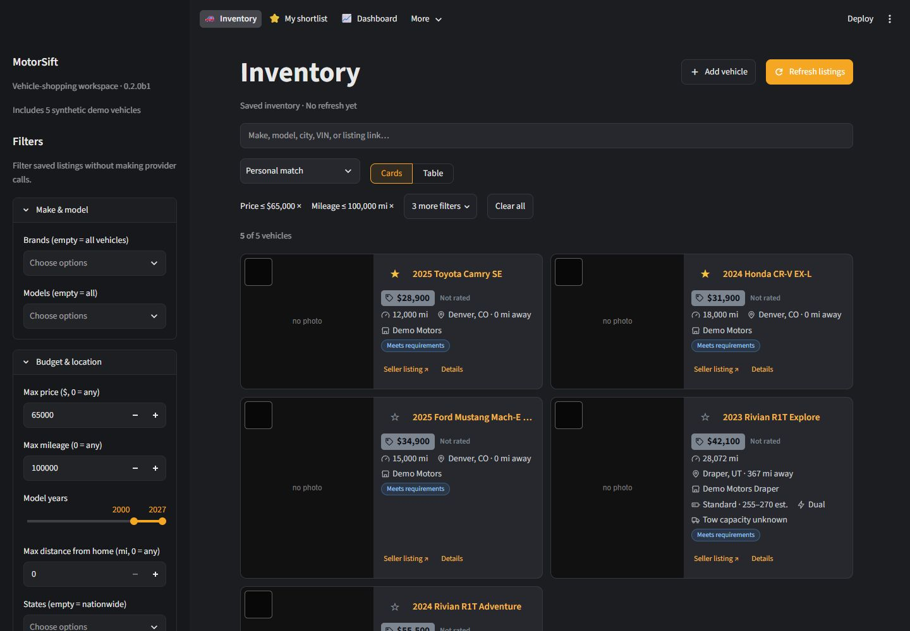

# MotorSift

**0.2.0 beta 1 — unreleased.** See the [changelog](CHANGELOG.md) and [release checks](docs/PUBLIC_RELEASE.md).

A local vehicle-shopping workspace for **cars, SUVs, vans, and pickups** across makes and models covered by
your automotive listing provider. Save the
models you want, choose which brands to refresh, and compare listings, price history, mileage, location,
equipment evidence, and acquisition costs. Manual entry, CSV/JSON import, email alerts, and pasted listings
work without an API account.

Source: [connorkeetch/truck-finder](https://github.com/connorkeetch/truck-finder) · [MIT license](LICENSE).



Synthetic demo data shown. [Vehicle details](docs/images/motorsift-details.jpg) · [Phone layout](docs/images/motorsift-mobile.jpg).

**New here?** The [Quickstart](docs/QUICKSTART.md) gets you running with demo data in about five minutes.
Every guide is listed in [docs/README.md](docs/README.md).

The app runs on your computer using Streamlit and SQLite. Automatic collection uses authorized APIs;
retail sites are covered through listings supplied by those APIs or information you choose to import.

## Start the app

The current development environment uses **Python 3.12 on Windows**. macOS/Linux launchers are included;
fresh-install and platform checks are listed in [Public release preparation](docs/PUBLIC_RELEASE.md).

1. Install Python 3.12. On Windows, enable **Add python.exe to PATH**.
2. Run `run.bat` on Windows, or `chmod +x run.sh && ./run.sh` on macOS/Linux.
3. The launcher creates `.venv`, installs `requirements.txt`, and opens
   [MotorSift](http://127.0.0.1:8501).
4. On an empty Inventory page, choose **Try demo**, **Set up my search**, or **Import listings**.
   In **Settings**, enter your home ZIP and choose your make/model searches, price, mileage, years, and distance.
   A fresh workspace starts with an editable Rivian R1T example. Existing workspaces keep their saved searches
   and preferences.

Optional desktop launchers: `scripts/create_desktop_shortcut.ps1` for Windows and
`scripts/create_mac_launcher.sh` for macOS.

## Choose how to collect listings

- **Try it without credentials:** choose **Try demo** on an empty Inventory page, or add listings by
  hand, CSV/JSON, pasted text, or saved-search email ([Importing listings](docs/IMPORTING.md)).
- **Auto.dev or MarketCheck:** follow [Get API keys and connect a provider](docs/API_KEYS.md) for account,
  subscription, and key-generation steps. Save one provider's key in **Settings → API credentials** locally,
  or in Railway service variables when hosted. Keys stay outside the inventory database.
- **Refresh:** press **Refresh listings** on Inventory, select brands or **All brands**, then press **Start search**. Opening or
  canceling the picker does not start a search. Saved display filters change the view without fetching listings.

Provider coverage, account limits, and radius restrictions vary. The app records requests, limits pages/retries,
and protects its configured monthly budgets; calls made outside this app are not included in those counters.
The app's 1,000-call Auto.dev and 500-call MarketCheck monthly safety budgets are local limits; they do not
show your subscription entitlement, remaining provider credit, or calls made elsewhere. See
[API setup and account limits](docs/API_KEYS.md), [Sources](docs/SOURCES.md), and current provider plans:
[Auto.dev](https://www.auto.dev/pricing), [MarketCheck](https://developers.marketcheck.com/).

## What you can customize

- Make/model searches and the brands refreshed in each run.
- Price, mileage, model years, distance, trims, deal ratings, seller type, and recorded price-drop filters.
- Sorting by deal rating, savings versus market, monthly payment, range, towing capacity, and price-change recency.
- Loan terms, APR scenarios, tax treatment, trade-in/payoff values, fees, and transport estimates.
- Optional feature-value adjustments, notes, favorites, and hidden listings.
- Personal must-haves and preferences, with a proof queue for favorite vehicles and a personal-match sort/filter.

Fresh finance figures are editable examples, with tax, trade-in, fees, and discounts initially zero. Enter your
own figures before using payment estimates. Range/warranty price adjustments and the EV fly-and-drive calculator
start disabled.

## What it tracks

Listings are deduplicated by validated VIN. Each source link and price/mileage observation is retained, so you
can compare changes over time. An incomplete or failed scan never marks unseen inventory as missing.
**Missing** means not observed in a complete scan; **removed** requires provider evidence or your action.

**Vehicle details → Price history** shows observed cut amounts and gaps between cuts, with sample sizes and
source dates. Rivian details also show the saved Rivian-seller benchmark. The calculations use recorded
observations without additional API calls; a short history is not a prediction of the next reduction.

Inventory cards badge new listings, price changes with dollar amounts, and listing status changes. The **Updates**
filter narrows results to those changes. A collapsed **Sold, removed & not seen** area on Inventory and Dashboard
keeps recent source removals and all unavailable vehicles accessible, including after later refreshes. Missing
listings remain distinct from confirmed removals. These views use saved history without extra API calls.

Equipment claims retain their source, confidence, and evidence. Unknown range, towing capacity, and warranty
details stay unknown until evidence is supplied. The app does not replace an individual vehicle's towing rating
with a model's advertised maximum.

The inventory offers cards, tables, comparisons, financing scenarios, notes, favorites, and Excel/CSV export.
Use the top navigation to move between pages. Inventory's sidebar groups filters, while search, sorting, and
the result count stay beside the vehicles. Active-filter summaries show what is narrowing your view.
Use **Add vehicle** for VIN lookup, paste, manual entry, or alert email. Listing-link checks and Excel export
live under **Sources → Tools**; feature-value adjustments live in Settings.

**My shortlist** keeps your favorites together with equipment evidence, copyable seller questions, and the
checklist/contact tools. Required equipment stays **Needs verification** until you confirm it; advertised claims
do not count as verified equipment. Saving requirements or viewing this page does not use listing API calls.
Optional scheduled runs and desktop alerts are available; they are off by default.

### Model-specific features

Rivian R1T battery, motor, generation, subframe, EPA-range, and warranty helpers remain available for that model.
Electric pickup presets include the Ford F-150 Lightning, Chevrolet Silverado EV, and GMC Sierra EV. General
vehicle searches do not imply that these specialist rules apply to every make/model. Provider-supplied facts and
your verified values are used where model-specific evidence is unavailable.

## Local data and sharing

Inventory, preferences, logs, backups, and exports normally live in `data/`. Downloaded thumbnail copies also
appear in `static/photos/`. Both directories, `.env`, and local development settings are excluded by `.gitignore`.
Do not include your working database, exported inventory, downloaded dealer photos, or credentials in a public
source release. Sample data in `examples/` and synthetic test fixtures can be used for demonstrations.

The MIT license covers this project's code. Listing data, photos, and third-party services remain subject to
their own terms; each user supplies their own provider account and credentials.

Access defaults to [localhost](http://127.0.0.1:8501). Optional PIN-protected phone access is available on your
home network. Database backups and JSON import/export are available in Settings.

For access away from home, see [Private Railway deployment](docs/CLOUD_DEPLOYMENT.md). The included image
protects the app with a private login and uses a persistent volume. Phone layouts include stacked inventory
cards, larger controls, and a compact comparison option.

## Development and tests

```powershell
py -3.12 -m venv .venv
.venv\Scripts\python -m pip install -r requirements.txt
.venv\Scripts\python -m pytest
```

On macOS/Linux, use `python3` and `.venv/bin/python`. Tests isolate their databases and data directories and use
stubbed providers, so they do not require inventory API credentials.

`app.py` starts the UI; `rivian_finder/` contains collection, parsing, storage, comparisons, and exports;
`extension/` contains the optional browser capture extension; `tests/` contains the test suite.
The internal package, environment variables, and data paths keep their existing names for compatibility.
The GitHub repository is still `connorkeetch/truck-finder`; the public app name is MotorSift.

Want to help? Read [Contributing](CONTRIBUTING.md) for setup and ground rules,
[How MotorSift works](docs/ARCHITECTURE.md) for the code layout, and [Improvements](docs/IMPROVEMENTS.md)
for known issues and good first tasks. Report security problems privately as described in
[SECURITY.md](SECURITY.md).

## Documentation

- [Quickstart](docs/QUICKSTART.md) · [User guide](docs/USER_GUIDE.md) · [Importing listings](docs/IMPORTING.md)
- [Get API keys](docs/API_KEYS.md) · [Sources](docs/SOURCES.md) · [Configuration](docs/CONFIGURATION.md) ·
  [Automation and command line](docs/AUTOMATION.md) · [Private Railway deployment](docs/CLOUD_DEPLOYMENT.md)
- [Troubleshooting](docs/TROUBLESHOOTING.md) · [Security](SECURITY.md)
- For contributors: [Contributing](CONTRIBUTING.md) · [How MotorSift works](docs/ARCHITECTURE.md) ·
  [Improvements](docs/IMPROVEMENTS.md) · [Release checks](docs/PUBLIC_RELEASE.md)
